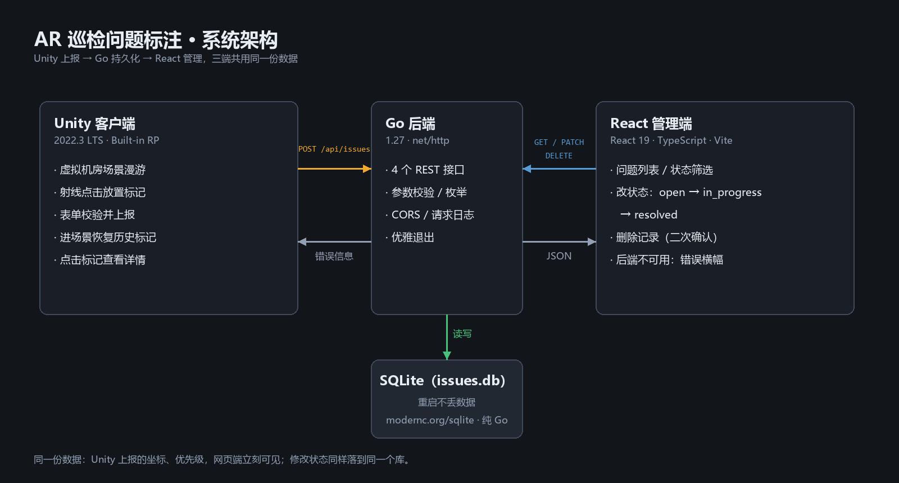

# 虚拟现场巡检问题标注（Unity + Go + React）

针对《Unity-3D 巡检实操题》**无 AR 设备备选版**的实现：在 Unity 里搭建一个虚拟机房，
用射线点击设备放置问题标记并上报，Go 后端持久化，React 网页查看并修改处理状态。

> 本项目是**普通 3D 场景**，不使用 AR Foundation / ARCore；第 8 节回答题面要求的 3 个 AR 基础问题。
> 另有一个独立的 XR Simulation 场景，用于演示“迁移到真实 AR”的流程（见 3.4 节）。

---

## 0. 整体架构



- **Unity 端**负责“现场”：自由漫游、射线命中放置标记、填写表单、提交；进场景时从后端恢复历史标记，点击标记看详情。
- **Go 端**是唯一数据源：参数校验、生成 ID 与时间戳、SQLite 持久化、CORS。
- **React 端**负责管理：列表、筛选、改状态、删除；后端不可用时显示错误横幅而不是白屏。

---

## 1. 目录结构

```
.
├── server/                 Go 后端（net/http + SQLite）
│   ├── main.go             启动、路由、优雅退出
│   ├── model.go            数据结构、枚举、参数校验
│   ├── store.go            SQLite 读写（modernc.org/sqlite，纯 Go 无需 CGO）
│   └── api.go              handler、统一响应、CORS、日志、recover
├── web/                    React 管理端（Vite + TypeScript）
│   └── src/
│       ├── api/            请求封装（拆 data 信封、错误转成中文）
│       ├── components/     表格、状态下拉、优先级标签、错误横幅
│       └── App.tsx         列表 / 筛选 / 改状态 / 错误态
└── unity/Inspection3D/     Unity 工程
    └── Assets/
        ├── Editor/SceneBuilder.cs        一键生成场景 + 一键构建 exe
        ├── Scripts/                      视角、射线放置、表单、API、标记、提示
        ├── Scripts/ARSimulationDemo.cs   XR Simulation 加分演示（平面检测 + 点击放置）
        ├── Scenes/Inspection.unity       主场景（生成的）
        ├── Scenes/ARSimulationDemo.unity AR 模拟演示场景
        └── Materials/                    生成的材质
```

---

## 2. 版本

| 部分 | 版本 |
|---|---|
| Unity | **2022.3.62f3c1 LTS**（Built-in Render Pipeline 模板） |
| Go | **1.27.3** |
| Node.js | 22.20.0 |
| React | 19 |
| Vite | 6.4.5 |
| TypeScript | 5.6 |
| 数据库 | SQLite（`modernc.org/sqlite`，纯 Go 驱动） |
| AR Foundation | 5.1.6（**仅用于加分项的 XR Simulation 演示**，主功能不依赖） |

---

## 3. 怎么启动

### 3.1 后端（先启动）

```powershell
cd server
go run .
# 或者直接跑已编译好的： .\inspection-server.exe
```

启动后监听 `http://127.0.0.1:8080`，数据库文件自动生成在 `server/data/issues.db`。

自检：

```powershell
curl http://127.0.0.1:8080/api/health
curl http://127.0.0.1:8080/api/issues
```

### 3.2 网页端

```powershell
cd web
npm install      # 首次
npm run dev      # http://127.0.0.1:5173
```

> 如果 PowerShell 报“禁止运行脚本”，用 `npm.cmd` 代替 `npm`，或执行
> `Set-ExecutionPolicy -Scope CurrentUser RemoteSigned`。

### 3.3 Unity 端

1. 用 Unity Hub 打开 `unity/Inspection3D`（编辑器版本 2022.3.62f3c1）。
2. 打开 `Assets/Scenes/Inspection.unity`。
3. 直接点 **Play**。

场景是脚本生成的，如果需要重建：菜单 **`巡检 / 1. 一键生成场景`**（会覆盖 `Inspection.unity`）。
需要独立可执行文件：菜单 **`巡检 / 2. 构建 Windows exe`**，输出 `Build/Inspection3D.exe`。

**操作方式**

| 按键 | 作用 |
|---|---|
| `W A S D` | 前后左右平移 |
| `Q / E` | 下降 / 上升 |
| 按住鼠标右键 | 拖拽转视角（松开即归还鼠标，方便点 UI） |
| 鼠标左键 | 点击设备或墙面，在命中点放置标记 |
| `Esc` | 关闭表单并删除未提交的标记 |

### 3.4 AR 模拟演示（加分项，可选）

`Assets/Scenes/ARSimulationDemo.unity` 用 AR Foundation 的 **XR Simulation** 在编辑器里模拟真实 AR：

1. 打开该场景（不要和 `Inspection.unity` 混在一起）
2. `Window → XR → AR Foundation → XR Environment`，Environment 选 `DefaultSimulationEnvironment`
3. Play，在 Game 视图里按住右键 + `WASD` 移动模拟设备，**左键点地面**放方块

这个场景只演示“平面检测 + 射线命中 + 锚定在平面上”，**不连后端、不属于主交付流程**，用来回答“如果把虚拟场景换成真实 AR 该怎么做”。

---

## 4. 后端地址怎么改

| 端 | 位置 | 说明 |
|---|---|---|
| Unity | 场景里 `Canvas/FormPanel` 上的 `IssueFormController.baseUrl` | 默认 `http://127.0.0.1:8080`；改成局域网 IP 后重新构建即可 |
| Web | `web/src/api/client.ts` 的 `API_BASE`，或环境变量 `VITE_API_BASE` | 默认 `http://127.0.0.1:8080` |

---

## 5. 接口设计

统一前缀 `/api`，统一信封：

```json
{ "data": { ... } }                                      // 成功
{ "data": { "items": [ ... ] } }                         // 列表（用对象包裹，方便 Unity 的 JsonUtility）
{ "error": { "code": "INVALID_ARGUMENT", "message": "title 不能为空" } }
```

| 方法 | 路径 | 请求体 | 成功 | 错误 |
|---|---|---|---|---|
| GET | `/api/health` | — | 200 `{"data":{"status":"ok","time":...}}` | — |
| POST | `/api/issues` | `{title, description, priority, position{x,y,z}}` | 201 + issue | 400 标题为空 / 枚举非法 / 缺坐标 |
| GET | `/api/issues` | — | 200 + items（`createdAt` 倒序） | — |
| GET | `/api/issues/{id}` | — | 200 + issue | 404 |
| PATCH | `/api/issues/{id}/status` | `{"status":"resolved"}` | 200 + issue | 400 枚举非法 / 404 不存在 |
| DELETE | `/api/issues/{id}` | — | 200 `{"data":{"id":"..."}}` | 404 不存在 |

**数据字段**（三端一致）：

```json
{
  "id": "由后端生成（32 位 hex）",
  "title": "1 号机柜温度异常",
  "description": "机柜右侧温度明显偏高",
  "priority": "high",
  "status": "open",
  "position": { "x": 1.25, "y": 0.8, "z": 2.4 },
  "createdAt": "2026-10-26T07:56:34Z",
  "updatedAt": "2026-10-26T07:56:34Z"
}
```

- `priority`：`low` / `medium` / `high`
- `status`：`open` / `in_progress` / `resolved`，新建固定为 `open`
- `id`、`status`、时间戳一律由服务端生成，客户端传入会被忽略（防伪造）
- 时间格式为 **RFC3339 UTC**

---

## 6. 已完成

**Unity 端**
- 基础体搭建的机房场景：地面、四面墙、两个机柜（带面板）、配电箱、管道、灭火器、木箱
- 自由视角（WASD / Q E / 右键拖拽），输入框聚焦时不会误移动镜头
- `Physics.Raycast` 命中检测，标记放在 **`hit.point`**（不是物体中心）
- 点在 UI 上不放置标记（射线检测前先判 `EventSystem.IsPointerOverGameObject`）
- 一次点击最多一个待提交标记；重复点击只移动它；取消或 `Esc` 删除未保存标记
- 表单：标题必填校验、描述可选、优先级三选一（含“当前：xxx”文字反馈）、实时显示坐标
- 提交成功：标记变绿并停止浮动、绿色 toast、面板关闭
- 提交失败：红色 toast + 行内错误、**保留标记与已填内容**便于重试
- 后端未启动时给“无法连接后端”的明确提示
- **AR Foundation + XR Simulation 演示**（加分项，独立场景 `ARSimulationDemo.unity`）：
  编辑器内模拟真实 AR 的平面检测（蓝色半透明网格）、点击平面放置方块（`ARRaycastManager` + `TrackableType.PlaneWithinPolygon`）；
  **仅为流程演示，未在真机验证**
- **进场景时自动从后端恢复历史标记**（加分项）：按记录的 x/y/z 摆回原坐标，
  红 = 待处理、橙 = 处理中、绿 = 已解决，黄色 = 本次待提交；
  标签 `#序号 优先级` 始终朝向相机；坐标非法或后端未启动时静默跳过
- 标记的 Collider 全部销毁，不会挡住鼠标射线
- **点击历史标记弹出详情面板**（加分项）：标题、优先级、状态、坐标、上报时间、描述；
  点「关闭」或按 `Esc` 收起；点场景空白处会自动收起并开始放置新标记

**Go 端**
- 4 个接口 + 健康检查，SQLite 持久化，重启后数据仍在
- 参数校验（标题必填/长度、priority 与 status 枚举、坐标有限性）
- CORS、请求日志、panic 恢复、请求体大小限制、优雅退出

**React 端**
- 列表显示标题、描述、优先级、状态、坐标、上报时间
- 状态下拉直接修改（`open` / `in_progress` / `resolved`），请求期间禁用并置灰
- 统计条数 + 按状态筛选 + 手动刷新
- 删除记录（二次确认），删除失败有错误提示
- 后端不可用时不白屏：红色错误横幅 + 重试按钮
- 空状态文案

---

## 7. 未完成 / 已知问题

- 恢复的标记本身只显示 `#序号 + 优先级`，**标记上的 3D 文字用 `TextMesh` 渲染，为避免中文字形缺失只放了 ASCII 字符**；
  中文标题/描述在点击后的右侧详情面板和网页里显示完整。
- 标记与问题没有做持久化绑定（没有把 `issueId` 写回标记对象）。
- 位置只有世界坐标，没有设备编号/区域等业务语义；同一坐标在不同时间上报无法区分设备。
- 没有登录、权限、删除、分页（数据量小，暂不需要）。
- 后端无鉴权与限流，仅监听 `127.0.0.1`，属于本机原型。
- **AR 部分只有 XR Simulation 演示，没有真机验证**：模拟环境无法体现真实的光照变化、纹理缺失、Tracking 抖动等问题；
  模拟场景里的方块也没有挂 `ARAnchor`（模拟环境中平面静止，看不出差别，真机上需要）。
- 场景由编辑器脚本生成，若手动改动场景后再执行“一键生成场景”，改动会被覆盖。

---

## 8. 题面第 5 节：三个 AR 基础问题

**Q1：改成真实 AR 后，平面检测和点击放置通常需要哪些 AR Foundation 能力？**

需要 `AR Session` + `XR Origin` 作为基础；`ARPlaneManager` 做水平面检测（Detection Mode = Horizontal，配合 `AR Default Plane` 预制体可视化）；`ARRaycastManager` 把屏幕点击转成射线，用 `TrackableType.PlaneWithinPolygon` 命中已识别平面；命中后取 `ARRaycastHit.pose` 在该位置实例化标记，并通过 `ARAnchorManager` 给标记挂 ARAnchor 以减少设备移动时的漂移。此外还需要 `ARCameraManager`（相机画面作背景）、相机权限申请，以及 `ARSession.state` 的状态检查。可选 `AROcclusionManager` 做遮挡。

**Q2：为什么只保存 Unity 中的 x/y/z 坐标，通常不能保证下次启动对应同一个真实位置？**

AR 的世界坐标系原点由**会话开始那一刻设备的位姿**决定，每次启动都不同，同一个墙角两次运行会得到完全不同的坐标；视觉里程计 + IMU 还会持续漂移，系统修正 tracking 时坐标系也会被微调；不同设备、不同尺度也不通用。只存三个数，等于存了“某个随机坐标系里的一个点”，没有与之绑定的地图信息。要跨启动还原，需要 ARCore Cloud Anchor、ARKit ARWorldMap 这类持久化锚点，或用二维码/图像标记做现场标定。

补充：本项目的虚拟场景世界原点是固定的（`Inspection.unity` 里的坐标恒定），所以存 x/y/z 就能精确还原位置 —— 这正是普通 3D 场景和真实 AR 最本质的差别。

**Q3：AR 初始化失败、设备不支持或 Tracking 异常时，应该如何提示用户？**

启动前检查 `ARSession.state` 与 ARCore 可用性：设备不在支持列表或未安装 Google Play Services for AR 时，明确提示“当前设备不支持 AR”并禁用放置功能，而不是让相机黑屏；相机权限被拒时提示并引导去系统设置开启；Tracking 变成 `Limited` 时提示“请缓慢移动手机、保证光线充足、对准有纹理的表面”；初始化超时或 Error 时提供“重试/重置会话”入口。核心原则是：任何异常都要有可读的中文状态提示和恢复入口，不能崩溃或静默失效。

---

## 9. 演示视频要点

**视频 A（Unity，3~4 分钟）**
1. 启动 exe，转动视角展示虚拟机房 —— **进场景时上次的历史标记已经按原坐标恢复在原处**（红/橙/绿）
2. 走到 1 号机柜，点击柜体侧面 → 标记落在**被点击的那个面**上，表单弹出并显示坐标
3. 点一下地面 → 标记移动、**没有出现第二个标记**
4. 空标题点提交 → 红字提示；填写「1 号机柜温度异常 / 右侧偏高 / high」提交 → 绿色成功提示、标记变绿
5. 再点管道 → 标记落下 → 点取消 → 标记消失
6. 停止运行再重新 Play → 刚才那条问题的标记**在新位置出现了**（坐标还原的证明点）
7. 点击任意彩色标记 → 右侧弹出详情（标题/优先级/状态/坐标/时间/描述），点关闭收起

**视频 B（网页 + 后端，2~3 分钟）**
1. 终端 `go run .`，`curl /api/health`
2. 浏览器 `http://127.0.0.1:5173`，刷新看到刚提交的记录（标题/优先级/状态/坐标）
3. 改成「处理中」，再改成「已解决」，刷新确认
4. **停掉 Go → 页面出现错误横幅且不白屏 → 重启 Go → 刷新数据仍在**
5. 删除一条记录（二次确认），列表即时更新
