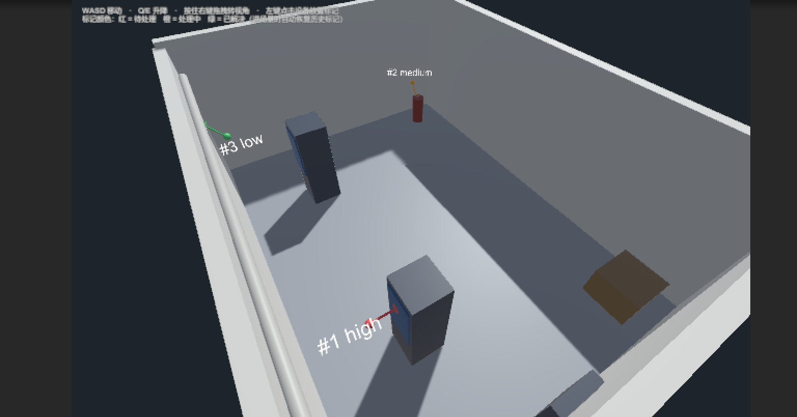
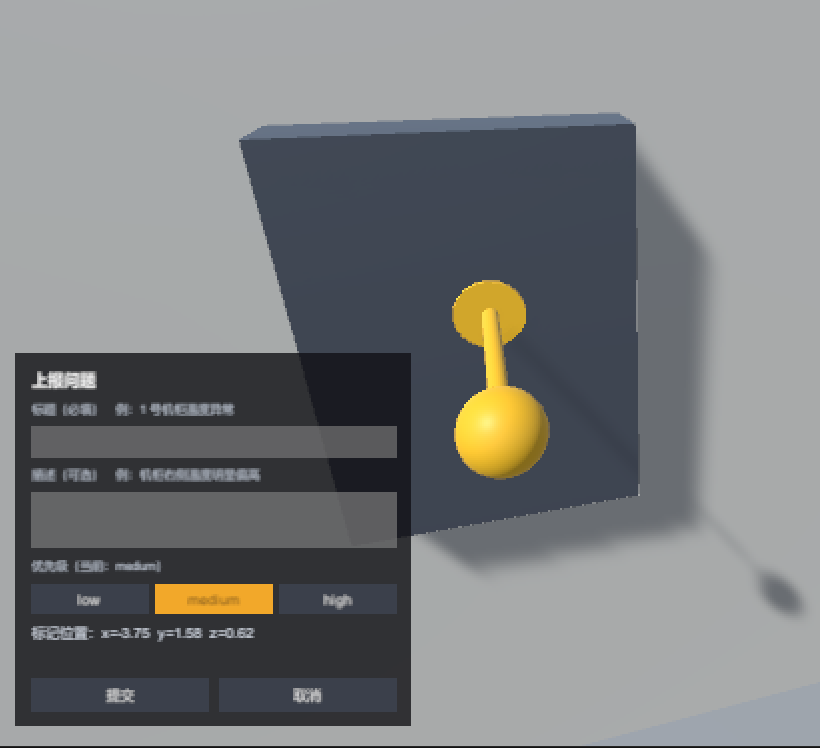
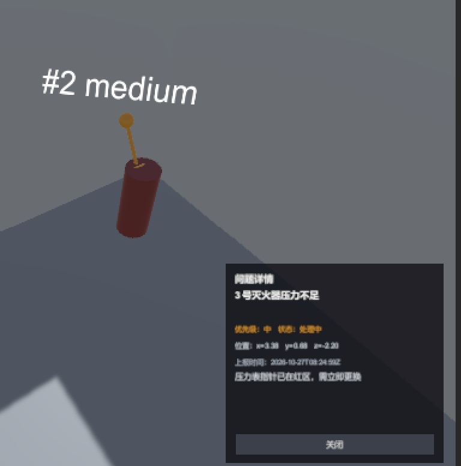
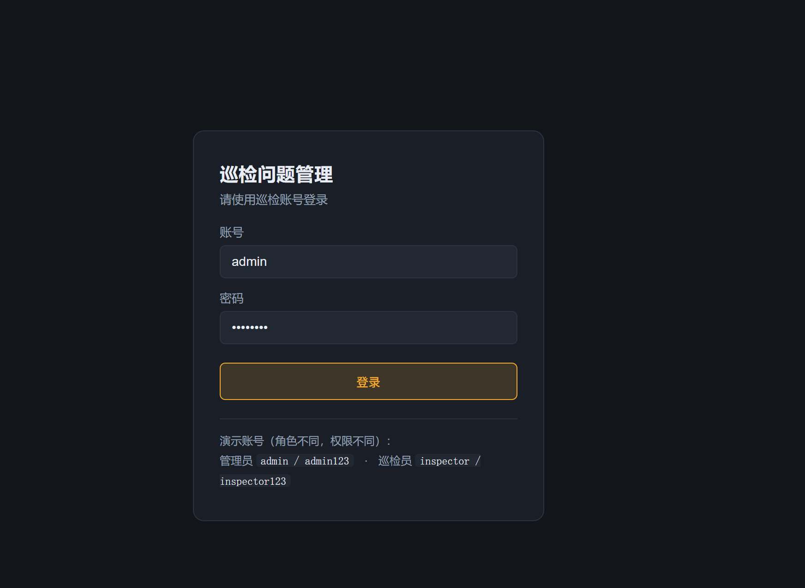
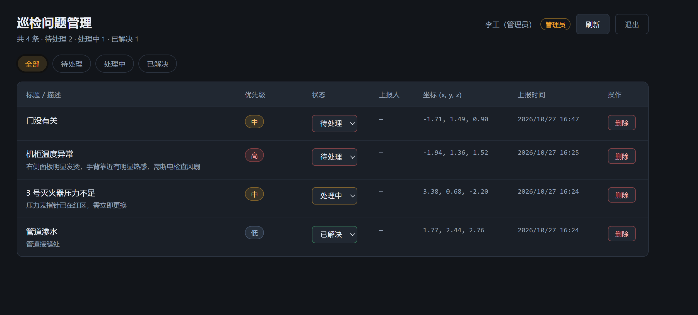
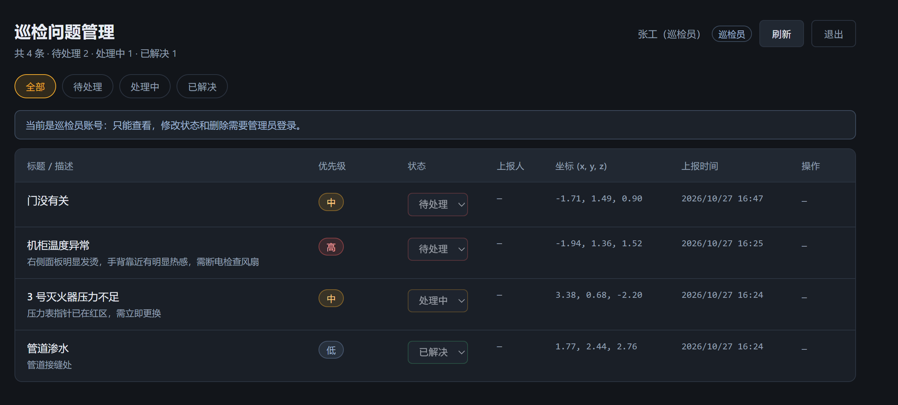
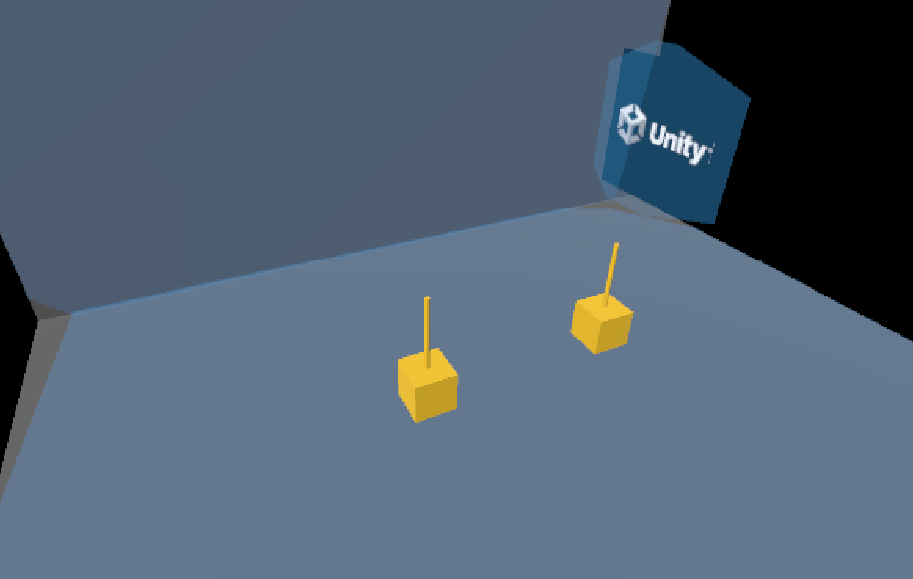

# 虚拟现场巡检问题标注（Unity + Go + React）

针对《Unity-3D 巡检实操题》**无 AR 设备备选版**的实现：在 Unity 里搭建一个虚拟机房，
用射线点击设备放置问题标记并上报，Go 后端持久化，React 网页查看并修改处理状态。

> 本项目是**普通 3D 场景**，不使用 AR Foundation / ARCore；第 8 节回答题面要求的 3 个 AR 基础问题。
> 另有一个独立的 XR Simulation 场景，用于演示“迁移到真实 AR”的流程（见 3.4 节）。

---

## 0. 整体架构


- **Unity 端**负责“现场”：自由漫游、射线命中放置标记、填写表单、提交；进场景时从后端恢复历史标记，点击标记看详情。
- **Go 端**是唯一数据源：参数校验、生成 ID 与时间戳、SQLite 持久化、CORS。
- **React 端**负责管理：列表、筛选、改状态、删除；后端不可用时显示错误横幅而不是白屏。

---

## 0.1 效果展示

| 巡检现场：三个标记按状态上色（红/橙/绿） | 点击设备后在命中点放置标记并填写 |
|---|---|
|  |  |

| 点击历史标记查看详情 | 管理端登录（演示账号，角色不同） |
|---|---|
|  |  |

| 管理员：可改状态、可删除，显示上报人/处理人 | 巡检员：只读，状态与删除被禁用 |
|---|---|
|  |  |

**XR Simulation 演示（加分项）**：编辑器内模拟真实 AR 的平面检测与点击放置



---

## 1. 目录结构

```
.
├── server/                 Go 后端（net/http + SQLite）
│   ├── main.go             启动、路由、优雅退出
│   ├── model.go            数据结构、枚举、参数校验
│   ├── store.go            SQLite 读写（modernc.org/sqlite，纯 Go 无需 CGO）
│   └── api.go              handler、统一响应、CORS、日志、recover
├── web/                    React 管理端（Vite + TypeScript）
│   └── src/
│       ├── api/            请求封装（拆 data 信封、错误转成中文）
│       ├── components/     表格、状态下拉、优先级标签、错误横幅
│       └── App.tsx         列表 / 筛选 / 改状态 / 错误态
└── unity/Inspection3D/     Unity 工程
    └── Assets/
        ├── Editor/SceneBuilder.cs        一键生成场景 + 一键构建 exe
        ├── Scripts/                      视角、射线放置、表单、API、标记、提示
        ├── Scripts/ARSimulationDemo.cs   XR Simulation 加分演示（平面检测 + 点击放置）
        ├── Scenes/Inspection.unity       主场景（生成的）
        ├── Scenes/ARSimulationDemo.unity AR 模拟演示场景
        └── Materials/                    生成的材质
```

---

## 2. 版本

| 部分 | 版本 |
|---|---|
| Unity | **2022.3.62f3c1 LTS**（Built-in Render Pipeline 模板） |
| Go | **1.27.3** |
| Node.js | 22.20.0 |
| React | 19 |
| Vite | 6.4.5 |
| TypeScript | 5.6 |
| 数据库 | SQLite（`modernc.org/sqlite`，纯 Go 驱动） |
| AR Foundation | 5.1.6（**仅用于加分项的 XR Simulation 演示**，主功能不依赖） |

**运行环境要求**

- Windows 10 / 11（启动脚本是 `.bat`；其它系统按第 3 节手动执行命令）
- Go **1.22+**（用到 `net/http` 的路径参数路由）
- Node.js **18+**（Vite 6 要求）
- Unity **2022.3 LTS**（只有要打开/重新生成 Unity 工程时需要；只看代码和后端不需要）
- 端口：`8080`（后端）、`5173`（前端），确保没被占用

> 无需 Android SDK、无需 ARCore、无需联网调用任何外部服务；数据全部落在本地 SQLite 文件。

---

## 3. 怎么启动

### 3.0 一键启动（Windows，推荐）

仓库根目录有四个批处理脚本，**双击即可**：

| 脚本 | 作用 |
|---|---|
| `start-all.bat` | 同时打开后端和管理端两个窗口 |
| `start-backend.bat` | 只启动 Go 后端（`http://127.0.0.1:8080`），会先检查端口是否被占用 |
| `start-web.bat` | 只启动管理端（`http://127.0.0.1:5173`），首次自动 `npm install`，几秒后自动打开浏览器 |
| `build-server.bat` | 编译出 `server/inspection-server.exe`，之后启动更快、也不依赖 `go` 命令 |

> 关掉窗口即停止对应服务。macOS / Linux 用户按下面 3.1 ~ 3.3 手动启动。

### 3.1 后端（先启动）

```powershell
cd server
go run .
# 或者直接跑已编译好的： .\inspection-server.exe
```

启动后监听 `http://127.0.0.1:8080`，数据库文件自动生成在 `server/data/issues.db`。

自检（健康检查是公开的；列表接口需要登录，见 3.2）：

```powershell
curl http://127.0.0.1:8080/api/health
```

### 3.2 网页端

```powershell
cd web
npm install      # 首次
npm run dev      # http://127.0.0.1:5173
```

打开后用演示账号登录（页面底部也写着）：

- 管理员：`admin` / `admin123` —— 可查看、上报、改状态、删除
- 巡检员：`inspector` / `inspector123` —— 只能查看和上报

> 如果 PowerShell 报“禁止运行脚本”，用 `npm.cmd` 代替 `npm`，或执行
> `Set-ExecutionPolicy -Scope CurrentUser RemoteSigned`。

### 3.3 Unity 端

1. 用 Unity Hub 打开 `unity/Inspection3D`（编辑器版本 2022.3.62f3c1）。
2. 打开 `Assets/Scenes/Inspection.unity`。
3. 直接点 **Play**。

Unity 端会以巡检员账号**自动登录**（账号密码在 `Canvas/FormPanel` 的 `IssueFormController` 上可改），
登录成功才会上报和恢复历史标记；后端未启动时会在顶部提示登录失败。

场景是脚本生成的，如果需要重建：菜单 **`巡检 / 1. 一键生成场景`**（会覆盖 `Inspection.unity`）。
需要独立可执行文件：菜单 **`巡检 / 2. 构建 Windows exe`**，输出 `Build/Inspection3D.exe`。

**操作方式**

| 按键 | 作用 |
|---|---|
| `W A S D` | 前后左右平移 |
| `Q / E` | 下降 / 上升 |
| 按住鼠标右键 | 拖拽转视角（松开即归还鼠标，方便点 UI） |
| 鼠标左键 | 点击设备或墙面，在命中点放置标记 |
| `Esc` | 关闭表单并删除未提交的标记 |

### 3.4 AR 模拟演示（加分项，可选）

`Assets/Scenes/ARSimulationDemo.unity` 用 AR Foundation 的 **XR Simulation** 在编辑器里模拟真实 AR：

1. 打开该场景（不要和 `Inspection.unity` 混在一起）
2. `Window → XR → AR Foundation → XR Environment`，Environment 选 `DefaultSimulationEnvironment`
3. Play，在 Game 视图里按住右键 + `WASD` 移动模拟设备，**左键点地面**放方块

这个场景只演示“平面检测 + 射线命中 + 锚定在平面上”，**不连后端、不属于主交付流程**，用来回答“如果把虚拟场景换成真实 AR 该怎么做”。

---

## 4. 后端地址怎么改

| 端 | 位置 | 说明 |
|---|---|---|
| Unity | 场景里 `Canvas/FormPanel` 上的 `IssueFormController.baseUrl` | 默认 `http://127.0.0.1:8080`；改成局域网 IP 后重新构建即可 |
| Web | `web/src/api/client.ts` 的 `API_BASE`，或环境变量 `VITE_API_BASE` | 默认 `http://127.0.0.1:8080` |

---

## 5. 接口设计

统一前缀 `/api`，统一信封：

```json
{ "data": { ... } }                                      // 成功
{ "data": { "items": [ ... ] } }                         // 列表（用对象包裹，方便 Unity 的 JsonUtility）
{ "error": { "code": "INVALID_ARGUMENT", "message": "title 不能为空" } }
```

除 `/api/health` 与 `/api/login` 外，其余接口都需要在请求头带 `Authorization: Bearer <token>`。

| 方法 | 路径 | 权限 | 请求体 | 成功 | 错误 |
|---|---|---|---|---|---|
| GET | `/api/health` | 公开 | — | 200 `{"data":{"status":"ok","time":...}}` | — |
| POST | `/api/login` | 公开 | `{username, password}` | 200 `{"data":{"token","user":{"username","displayName","role"}}}` | 401 账号或密码不正确 |
| POST | `/api/issues` | 巡检员 / 管理员 | `{title, description, priority, position{x,y,z}, normal{x,y,z}?}` | 201 + issue（`reporter` 自动填当前用户） | 400 标题为空 / 枚举非法 / 401 未登录 |
| GET | `/api/issues` | 登录即可 | — | 200 + items（`createdAt` 倒序） | 401 未登录 |
| GET | `/api/issues/{id}` | 登录即可 | — | 200 + issue | 401 / 404 |
| PATCH | `/api/issues/{id}/status` | **仅管理员** | `{"status":"resolved"}` | 200 + issue（`statusChangedBy` 自动填） | 400 枚举非法 / 401 / **403 无权限** / 404 |
| DELETE | `/api/issues/{id}` | **仅管理员** | — | 200 `{"data":{"id":"..."}}` | 401 / 403 / 404 |

**演示账号**（内置，内存中，重启服务后 token 失效需重新登录）：

| 账号 | 密码 | 角色 | 权限 |
|---|---|---|---|
| `inspector` | `inspector123` | 巡检员 | 查看 + 上报 |
| `admin` | `admin123` | 管理员 | 查看 + 上报 + 改状态 + 删除 |

**数据字段**（三端一致）：

```json
{
  "id": "由后端生成（32 位 hex）",
  "title": "1 号机柜温度异常",
  "description": "机柜右侧温度明显偏高",
  "priority": "high",
  "status": "open",
  "position": { "x": 1.25, "y": 0.8, "z": 2.4 },
  "normal": { "x": 0, "y": 0, "z": 1 },
  "reporter": "张工（巡检员）",
  "statusChangedBy": "",
  "createdAt": "2026-10-26T07:56:34Z",
  "updatedAt": "2026-10-26T07:56:34Z"
}
```

- `priority`：`low` / `medium` / `high`
- `status`：`open` / `in_progress` / `resolved`，新建固定为 `open`
- `position`：命中点的世界坐标（米）
- `normal`：命中处的表面法线，用来还原标记**朝向**（贴在墙上是横的，贴在地面上是竖的）；
  不传时后端按 `{0,1,0}`（朝上）写入，旧数据也按朝上处理
- `reporter` / `statusChangedBy`：**由服务端按登录用户自动填写**，客户端传入无效（审计字段）
- `id`、`status`、时间戳一律由服务端生成，客户端传入会被忽略（防伪造）
- 时间格式为 **RFC3339 UTC**

---

## 5.1 设计取舍（几个关键决定）

| 决定 | 放弃的方案 | 为什么 |
|---|---|---|
| 登录用**内存账号 + 随机 token** | JWT / 落库用户表 | 原型只需要“能证明权限边界”，内存实现 60 行且无依赖；代价是重启后要重新登录，已写进“已知问题” |
| 权限放在**后端中间件**校验 | 只在前端隐藏按钮 | 前端隐藏按钮只是体验，真正的边界必须在服务端；否则改请求就能越权 |
| 巡检员/管理员两种角色 | 只做“登录/未登录” | 巡检场景天然分两种人：现场上报 vs 后台处理；两种角色才能讲清楚权限差异 |
| `reporter` / `statusChangedBy` 由服务端填 | 让客户端传 | 客户端可伪造；审计字段必须服务端按 token 落库 |
| 走官方「无 AR 设备备选版」 | 硬凑 ARCore 真机 | 手头没有支持 ARCore 的设备，硬凑的交付确定性低；题面明确不因此扣分 |
| 列表接口返回 `{"data":{"items":[...]}}` | 直接返回 JSON 数组 | Unity 的 `JsonUtility` 不支持顶层数组，包一层就能零依赖解析，省掉 Newtonsoft |
| 标记放在 `hit.point`，并记录 `normal` | 只存坐标、标记永远竖直 | 只存坐标会导致重启后朝向丢失（这个 bug 实际发生过）；多存一个法线就能对齐“钉在哪个面” |
| SQLite 驱动用 `modernc.org/sqlite` | `mattn/go-sqlite3`（需 CGO） | 纯 Go 驱动，Windows 上不需要装 gcc/MinGW，评审机器也能直接跑 |
| 状态用 `PATCH /status` | `PUT` 整个对象 | 只改一个字段，语义准确，也避免并发覆盖其它字段 |
| 待提交标记**不挂** Collider，历史标记挂 | 所有标记都挂 Collider | 挂了会挡住放置射线，导致“点标记反而生成新标记”；历史标记需要被点中看详情，才单独加 |
| 后端统一 `{data}` / `{error:{code,message}}` 信封 | 直接返回对象或用 HTTP 状态码表意 | 三端都能拿到可读的中文错误信息，Unity 端可以直接弹给用户 |
| 前端不引 UI 框架 | Ant Design / MUI | 依赖少、体积小，评审可以直接读源码而不是读框架文档 |
| 提供 `.bat` 一键脚本 | 只写命令行步骤 | 评审不需要懂 PowerShell / npm 就能跑起来，减少“跑不起来”的风险 |

---

## 6. 已完成

**Unity 端**
- 基础体搭建的机房场景：地面、四面墙、两个机柜（带面板）、配电箱、管道、灭火器、木箱
- 自由视角（WASD / Q E / 右键拖拽），输入框聚焦时不会误移动镜头
- `Physics.Raycast` 命中检测，标记放在 **`hit.point`**（不是物体中心）
- 点在 UI 上不放置标记（射线检测前先判 `EventSystem.IsPointerOverGameObject`）
- 一次点击最多一个待提交标记；重复点击只移动它；取消或 `Esc` 删除未保存标记
- 表单：标题必填校验、描述可选、优先级三选一（含“当前：xxx”文字反馈）、实时显示坐标
- 提交成功：标记变绿并停止浮动、绿色 toast、面板关闭
- 提交失败：红色 toast + 行内错误、**保留标记与已填内容**便于重试
- 启动时以**巡检员账号自动登录**（Inspector 面板可改账号密码），后续请求自动带 `Authorization`；
  未登录时跳过历史标记恢复，只提示不崩溃
- 后端未启动时给“无法连接后端”的明确提示
- **AR Foundation + XR Simulation 演示**（加分项，独立场景 `ARSimulationDemo.unity`）：
  编辑器内模拟真实 AR 的平面检测（蓝色半透明网格）、点击平面放置方块（`ARRaycastManager` + `TrackableType.PlaneWithinPolygon`）；
  **仅为流程演示，未在真机验证**
- **进场景时自动从后端恢复历史标记**（加分项）：按记录的 x/y/z 摆回原坐标，
  红 = 待处理、橙 = 处理中、绿 = 已解决，黄色 = 本次待提交；
  标签 `#序号 优先级` 始终朝向相机；坐标非法或后端未启动时静默跳过
- 标记的 Collider 全部销毁，不会挡住鼠标射线
- 标记由「底座圆盘 + 立杆 + 球头」组成：圆盘正压在命中点，钉子**垂直于被点的表面**（点墙是横的、点地面是竖的），
  朝向随 `normal` 一起存进后端，**重启后仍然保持原来方向**
- **点击历史标记弹出详情面板**（加分项）：标题、优先级、状态、坐标、上报时间、描述；
  点「关闭」或按 `Esc` 收起；点场景空白处会自动收起并开始放置新标记

**Go 端**
- 5 个接口（含登录）+ 健康检查，SQLite 持久化，重启后数据仍在
- 参数校验（标题必填/长度、priority 与 status 枚举、坐标有限性）
- **登录与权限**：`POST /api/login` 下发 token（8 小时有效），中间件校验 `Authorization: Bearer`；
  巡检员只能查看/上报，改状态与删除仅管理员；越权返回 403、未登录返回 401
- **审计字段**：`reporter`（谁上报）、`statusChangedBy`（谁改的状态）由服务端按登录用户写入，客户端传了也无效
- CORS（允许 `Authorization` 头）、请求日志、panic 恢复、请求体大小限制、优雅退出

**React 端**
- 登录页（账号密码），token 存 localStorage，401 自动清登录态回到登录页
- 顶栏显示当前用户与角色；**管理员**可改状态/删除，**巡检员**只读并给出提示
- 列表显示标题、描述、优先级、状态、**上报人 / 处理人**、坐标、上报时间
- 状态下拉直接修改（`open` / `in_progress` / `resolved`），请求期间禁用并置灰
- 统计条数 + 按状态筛选 + 手动刷新 + 退出登录
- 删除记录（二次确认），删除失败有错误提示
- 后端不可用时不白屏：红色错误横幅 + 重试按钮
- 空状态文案

---

## 7. 未完成 / 已知问题

- 恢复的标记本身只显示 `#序号 + 优先级`，**标记上的 3D 文字用 `TextMesh` 渲染，为避免中文字形缺失只放了 ASCII 字符**；
  中文标题/描述在点击后的右侧详情面板和网页里显示完整。
- 标记与问题没有做持久化绑定（没有把 `issueId` 写回标记对象）。
- 位置只有世界坐标，没有设备编号/区域等业务语义；同一坐标在不同时间上报无法区分设备。
- 账号是**内置在内存**里的（两个演示账号），没有用户管理界面，也不落库；
  服务重启后 token 全部失效，需要重新登录。
- 没有分页（数据量小）、没有操作审计日志（只记了“谁上报/谁处理”，没有逐条变更历史）。
- 仅监听 `127.0.0.1`，没有 HTTPS、没有限流，属于本机原型。
- **AR 部分只有 XR Simulation 演示，没有真机验证**：模拟环境无法体现真实的光照变化、纹理缺失、Tracking 抖动等问题；
  模拟场景里的方块也没有挂 `ARAnchor`（模拟环境中平面静止，看不出差别，真机上需要）。
- 场景由编辑器脚本生成，若手动改动场景后再执行“一键生成场景”，改动会被覆盖。

---

## 8. 题面第 5 节：三个 AR 基础问题

**Q1：真要跑在手机上，平面检测和点击放置要用哪些 AR Foundation 能力？**

主要是三样：`AR Session` 起会话，`ARPlaneManager` 找水平面（挂个平面预制体就能把网格画出来），`ARRaycastManager` 把点击转成射线、用 `PlaneWithinPolygon` 判断点到了哪块平面。命中之后按 `ARRaycastHit.pose` 在那个位置放标记；想稳一点再挂 `ARAnchorManager` 的锚点，减少走动时的漂移。相机画面和权限靠 `ARCameraManager`，另外要检查 `ARSession.state`。

**Q2：为什么只存 x/y/z，下次启动通常对不回同一个真实位置？**

因为 AR 的坐标原点是**这次打开 App 时设备所在的位置**，每次启动都不一样——同一个墙角，今天和明天存下来的三个数完全不同。而且视觉里程计会漂移，系统修正 tracking 时坐标系还会被微调。只存坐标，等于存了“某次会话坐标系里的一个点”，没有能对回现实的地图；要跨启动还原，得用 CloudAnchor、ARWorldMap 这类持久化锚点，或者现场贴二维码做标定。

顺带一句：我们这个虚拟场景的原点是固定的，所以存坐标就能还原——这正好是普通 3D 和真 AR 的分界线。

**Q3：AR 初始化失败、设备不支持、Tracking 异常时怎么提示？**

分开处理，别让人对着黑屏发呆：设备不支持或没装 ARCore，就直接说“这台设备不支持 AR”，顺手把放置功能关掉；相机权限被拒，提示去设置里开；Tracking 变差（`Limited`）就让他慢点动、找光线好和有纹理的地面；初始化失败或报错，给个“重试/重置会话”的入口。原则是任何异常都得有中文提示、有恢复入口，不能崩，也不能静默失效。

---

## 9. 常见问题

| 现象 | 原因 / 处理 |
|---|---|
| `bind: Only one usage of each socket address` / 登录报「接口不存在: POST /api/login」 | 8080 上还是**旧的后端进程**（改完代码没重启）。`start-backend.bat` 会检测到并询问是否结束旧进程；也可以手动关掉那个窗口再启动 |
| PowerShell 报“禁止运行脚本”（`npm.ps1`） | 用 `npm.cmd`，或执行 `Set-ExecutionPolicy -Scope CurrentUser RemoteSigned` |
| 网页打开是空白 / 报 `ERR_CONNECTION_REFUSED` | 后端没启动；先双击 `start-backend.bat` |
| 网页显示“无法连接后端”红色横幅 | 后端停了或端口变了；这是**预期行为**（不白屏），重启后端后点「重试」 |
| Unity 里点场景没有反应 | 检查 `GameManager` 上是否挂了 `MarkerPlacementController`；若刚改过 UI，请重新执行 `巡检 / 1. 一键生成场景` |
| Unity 里标记全变竖直 | 旧数据没有 `normal` 字段；重新提交一条即可，或删除 `server/data/issues.db` 重来 |
| `inspection-server.exe` 被占用无法替换 | 先关掉正在运行的后端窗口，再运行 `build-server.bat` |
